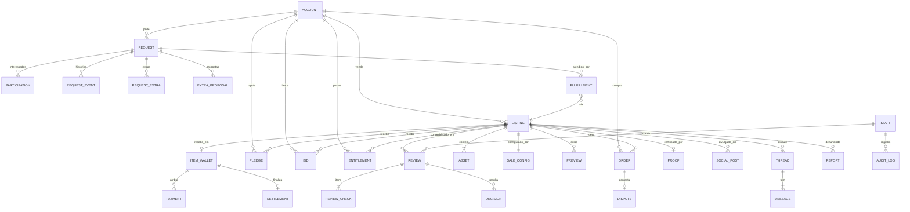

# 06 · Modelo de dados

PostgreSQL. IDs são UUID v7 (ordenáveis no tempo). Valores monetários em **micro-USD inteiros** (`bigint`, 6 casas); stablecoins valem 1:1. Pagamentos em Bitcoin guardam a cotação BTC/USD da confirmação. Campos `created_at`/`updated_at` em todas as tabelas (omitidos abaixo).

## 1. Diagrama



## 2. Entidades

### account
| campo | tipo | nota |
|---|---|---|
| id | uuid | |
| handle | text unique | `coruja-7f3a`; imutável |
| password_hash | text | Argon2id |
| recovery_hash | text | hash da frase de 12 palavras |
| totp_secret_enc | bytea null | cifrado |
| passkeys | jsonb | credenciais WebAuthn |
| access_keys | jsonb | arquivos de acesso: `{public_key, fingerprint, pin_protected, created_at, last_used_bucket, revoked_at}` (só a chave pública) |
| roles | text[] | `buyer`, `seller` (toda conta pode ser ambos) |
| status | enum | `active`, `restricted`, `banned`, `deleted` |
| reputation | jsonb | `{score, approved, rejected, disputes_lost, since}` |
| (sem saldo) | — | a conta não tem saldo; pagamentos e recebimentos vivem nas carteiras dos itens |
| prefs | jsonb | tema, notificações, idioma, país padrão |
| last_seen_bucket | date | granularidade de dia; nunca timestamp exato |

Sem e-mail, telefone, nome, IP.

### listing
| campo | tipo | nota |
|---|---|---|
| id, slug | uuid, text | slug público aleatório (`lcr-9f2k7`) |
| seller_id | uuid → account | |
| title, summary, description | text | descrição em Markdown restrito |
| category_id | int → category | |
| countries | text[] | códigos ISO 3166-1 alpha-2 ou `GLOBAL`; filtro de primeira classe |
| languages | text[] | idiomas do material (ISO 639-1) |
| tags | text[] | |
| content_types | enum[] | um ou mais de `document`, `dataset`, `image`, `video`, `audio`, `text`, `code` |
| risk_level | enum | `low`, `medium`, `high` (herda da categoria, curador pode subir) |
| authenticity | enum null | `verified`, `partial`, `plausible`, `unverified` |
| model | enum | `copies`, `exclusive`, `crowdfund`, `request_fulfillment`, `auction`, `tiers`, `subscription`, `window`, `license`, `consult` |
| status | enum | ver máquina de estados |
| deadline_at | timestamptz | |
| published_at, closed_at | timestamptz null | |
| version | int | incrementa a cada reenvio |
| declarations | jsonb | 6 declarações aceitas + versão do texto + timestamp |
| curated_title, curated_summary | text null | reescritos pela curadoria, se houver |
| ai_suggested | jsonb | título, resumo, descrição e tags sugeridos pela leitura dos arquivos (OCR/transcrição, na própria infraestrutura) e se o vendedor os manteve |
| stats | jsonb | views, favorites, shares (contadores agregados) |

### sale_config (1:1 com listing, JSONB validado por modelo)
```jsonc
// copies
{ "price": 49000, "limit": 100, "sold": 37, "tiers": [{"upto": 10, "price": 29000}, {"upto": null, "price": 49000}], "buyout_price": 3500000 }
// exclusive
{ "price": 2500000, "accept_offers": true, "min_offer": 1500000, "exclusivity_months": 24, "guarantee_holdback_pct": 20 }
// crowdfund
{ "goal": 8000000, "raised": 5412000, "backers": 1187, "buyout_price": 25000000, "failure_rule": "milestones_kept", "flexible_min_pct": null,  "milestone_previews": {"25": "preview_id", "50": "preview_id", "75": "preview_id", "90": "preview_id"} }
// auction
{ "kind": "open" | "sealed_first" | "sealed_second" | "dutch", "start_price": 1500000, "reserve": 2000000, "increment": 50000, "anti_snipe_min": 10, "dutch": {"step": 100000, "every_min": 60, "floor": 800000} }
// tiers
{ "tiers": [{"id": "t1", "label": "Sumário executivo", "price": 19000, "asset_ids": []}, {"id": "t2", "label": "Relatório completo", "price": 89000}, {"id": "bundle", "price": 240000}], "buyout_price": 2000000 }
// buyout_price (opcional em copies, crowdfund e tiers): valor que encerra o anúncio e entrega o item a um único comprador
// subscription
{ "period": "weekly" | "biweekly" | "monthly", "price": 19000, "back_issue_price": 9000, "subscribers": 212 }
// window
{ "window_price": 1500000, "window_days": 7, "after_model": "copies", "after_price": 29000 }
// license
{ "editorial": 90000, "commercial": 450000, "exclusive": 2500000, "territory": "BR", "term_months": 12 }
```

### asset
| campo | tipo | nota |
|---|---|---|
| id, listing_id | | |
| kind | enum | `main`, `tier`, `preview_source` |
| filename, mime, size_bytes | | nome original pode ser renomeado pela curadoria |
| sha256_client, sha256_server | text | devem bater |
| storage_key | text | bucket selado |
| dek_encrypted | bytea | DEK cifrada pela KEK |
| dek_destroyed_at | timestamptz null | crypto-shredding |
| metadata_report | jsonb | o que foi removido |
| scan_report | jsonb | AV, PII, proibido, duplicidade |
| ocr_index_id | text null | referência ao índice interno |
| version | int | redações criam nova versão; a anterior fica inacessível |

### preview
`id, listing_id, asset_id, type (blurred_image|redacted_page|clip|sample_rows|text_excerpt|cover), storage_key (bucket público), approved bool, order`

### proof
`id, listing_id, package_sha256, assets_sha256 jsonb, issued_at, policy_version, authenticity, curated_by_count, anchor (opcional: txid OpenTimestamps), public_url`

### order
`id, listing_id, buyer_id, kind (copy|exclusive|buyout|tier|license|window|back_issue), amount, fee, status (created|paid|delivered|settled|disputed|refunded|partially_refunded), tier_id null, license_kind null, dispute_deadline_at, settled_at`

### pledge (lacre coletivo)
`id, listing_id, backer_id, amount, kept_amount (parte garantida ao vendedor se o lacre falhar), status (held|released|kept|partially_refunded|refunded), created_at`

### bid / offer
`id, listing_id, bidder_id, amount, kind (open|sealed|dutch_accept|offer), status (active|outbid|won|lost|withdrawn|accepted|rejected|countered), payment_id → payment (lance pago na hora; reembolsado se não vencer)`

### subscription
`id, listing_id, subscriber_id, period_start, period_end, status (active|paused|cancelled), price_locked`

### entitlement
`id, account_id, listing_id, source (order|pledge|subscription|request|public_release), payment_id, available_at (quando o acesso abre), asset_scope (all|tier:t1), can_download bool, watermark_id text, expires_at null, revoked_at null`

### review / review_check / decision
`review (id, listing_id, listing_version, reviewer_id, role (first|second|legal), started_at, finished_at, authenticity_proposed, notes, status)`
`review_check (id, review_id, block 1..7, code, checked bool, note)`
`decision (id, review_id, outcome (approve|approve_edited|changes|reject|escalate|ban), reason_codes text[], message_to_seller, edits jsonb, decided_at)`

### social_post
`id, listing_id, channel (x|telegram|bluesky|instagram|threads|rss), kind (launch|milestone_25|milestone_50|milestone_75|milestone_90|funded|sold|closing_soon|released), body, media_key, scheduled_at, posted_at, external_id, status (draft|scheduled|posted|failed), metrics jsonb`

### request / contribution / fulfillment
`request (id, author_id, title, description, acceptance_criteria, category_id, countries text[], languages text[], price_per_party (valor por interessado atual), parties_active, reward_total (= price_per_party × parties_active), deadline_at, match_until null (fim da janela de igualar), status (draft|in_review|open|raised|locked|fulfilled|expired|rejected), allow_copies_after bool default false, created_at)`
`participation (id, request_id, account_id, paid_total, status (active|must_match|left|refunded|delivered), joined_at, matched_at null, left_at null)` todos os ativos pagaram o mesmo valor
`request_event (id, request_id, extra_id null, account_id, kind (open|join|raise|match|leave|auto_leave|lock|unlock|fulfill|expire|extra_created|proposal), amount null, created_at)` linha do tempo pública
`request_extra (id, request_id, created_by, title, description, acceptance_criteria, price_per_party, parties_active, reward_total, deadline_at (≤ pedido), match_until null, status (in_review|open|raised|locked|fulfilled|expired|rejected), created_at)` sub-item opcional; carteira própria (`item_wallet.extra_id`); participações com `participation.extra_id`
`extra_proposal (id, request_id, seller_id, title, description, suggested_price, status (open|adopted|withdrawn), adopted_extra_id null, created_at)` proposta pública de vendedor
`fulfillment (id, request_id, seller_id, listing_id, status (submitted|in_review|accepted|rejected))`

### thread / message
`thread (id, listing_id null, request_id null, participants uuid[2], expires_at)`
`message (id, thread_id, sender_id, body, filtered bool, filtered_reasons text[], read_at)`

### dispute
`id, order_id, opener_id, reason (mismatch|corrupted|duplicate|authenticity|other), description, evidence jsonb, status (open|under_review|resolved_refund|resolved_partial|resolved_uphold|withdrawn), resolver_id, resolution_note, resolved_at`

### report (denúncia pública)
`id, listing_id, reason (personal_data|copyright|forgery|illegal|other), description, contact_optional (nunca obrigatório), status (new|triaged|suspended_item|dismissed|actioned), handled_by`

### item_wallet / payment / settlement / refund
`item_wallet (id, listing_id null, request_id null, asset (usdt|usdc|btc), network, xpub, root_address (público, na prova), state (receiving|settling|delivered|refunding|closed), received_total, refunded_total, created_at, delivered_at, key_shredded_at)` chave privada só no HSM
`payment (id, item_wallet_id, account_id, kind (copy|exclusive|buyout|tier|license|pledge|request_join|request_raise|request_match), derivation_index, address, expected_amount, received_amount, confirmations, txid, origin_address (apagado na finalização), state (waiting|seen|confirmed|settled|refunded|expired), created_at, confirmed_at)`
`settlement (id, item_wallet_id, commission_amount, commission_txid, refunds_count, seller_net, seed_revealed_at, key_shredded_at, audit_hash)`
`refund (id, payment_id, amount, network_fee, txid, reason (failed_goal|expired_request|left_request|dispute|removed_item|buyout), state (queued|sent|confirmed), created_at)`

Não existe saldo de usuário nem ledger de carteiras: o livro de pagamentos por item é o espelho do que está on-chain.

### staff / audit_log
`staff (id, name, role (triage|curator|senior|legal|finance|publisher|admin), totp_enforced, status)`
`audit_log (id, staff_id, action, target_type, target_id, before jsonb, after jsonb, prev_hash, hash)` encadeado

### category
`id, name, slug, default_risk, two_eyes_required, legal_review_default`

## 3. Máquinas de estado

### listing.status
```
draft → submitted → triage → in_review → (changes_requested ⇄ submitted)
in_review → escalated → in_review
in_review → approved → active (publicação imediata; carteira do item criada)
in_review → rejected
active → funded (crowdfund) → public (na hora, para todos) → settled (72 h depois) → closed
active → sold (exclusive/auction/window, ou buyout em copies/crowdfund/tiers: apoios reembolsados) → settled (comissão separada, carteira entregue) → closed
active → closed (deadline ou vendedor encerra as vendas) → settled (finalização)
active → suspended (denúncia) → active | removed
closed → archived
```

### order.status
`created → paid → delivered → settled` · `delivered → disputed → refunded | partially_refunded | settled`

### pledge.status
`held → released` (meta batida) · `held → kept` (lacre não bateu a meta, apoio até o último marco batido) · `held → refunded` (entrou depois do último marco, nenhum marco batido ou item removido; o apoio que cruzou o marco é parcialmente reembolsado)

### bid.status
`active → outbid` · `active → won | lost` · `active → withdrawn` (só em holandês antes de aceitar)

### dispute.status
`open → under_review → resolved_refund | resolved_partial | resolved_uphold` · `open → withdrawn`

## 4. Índices e consultas quentes

- `listing (status, category_id, model, published_at desc)` e índice GIN em `countries` para o catálogo.
- `listing (status, risk_level, submitted_at)` para a fila.
- `entitlement (account_id, listing_id)` único por escopo.
- `payment (item_wallet_id, state)`, `(account_id, created_at)`, `(address)` único.
- `pledge (listing_id, status)` para somatórios; `sale_config.raised` atualizado por trigger.
- `asset (sha256_server)` para duplicidade.
- Busca pública: `tsvector` em título + resumo + tags (pt-BR). Busca interna da curadoria inclui OCR.

## 5. Retenção e destruição

| Dado | Retenção |
|---|---|
| Conteúdo de exclusivo vendido | DEK destruída 72 h após entrega |
| Conteúdo de item rejeitado | 30 dias (para recurso), depois DEK destruída |
| Conteúdo de item finalizado (cópias) | Enquanto houver entitlements ativos + 12 meses |
| Mensagens | 90 dias após encerramento do item |
| Registros de acesso (Marco Civil) | 6 meses, sistema separado |
| Livro de pagamentos por item (sem endereços de origem) | Permanente |
| Audit log | Permanente |
| Chave da carteira do item | Destruída no HSM no momento da entrega ao vendedor |
| Endereço de origem dos pagamentos | Apagado na finalização do item (serve só para reembolsos) |
| Conta excluída pelo usuário | Pseudônimo marcado como `deleted`, sem itens com carteira em andamento, entitlements revogados, livro de pagamentos mantido |
